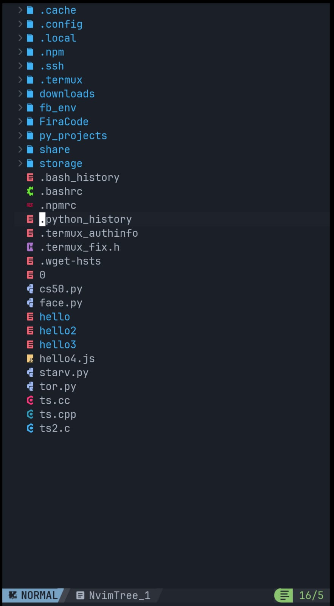
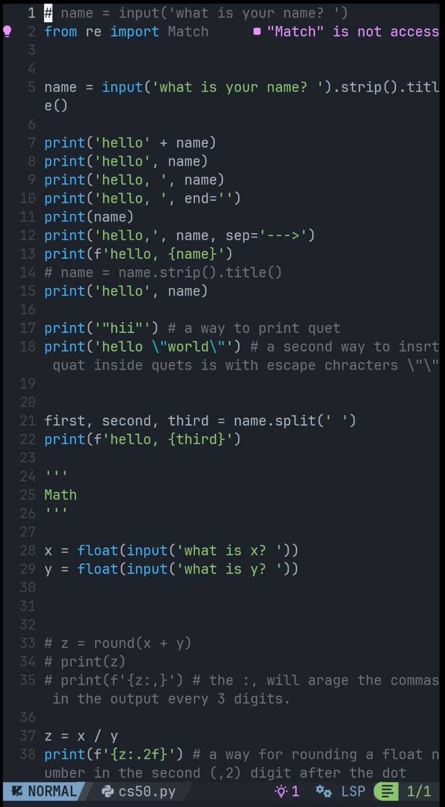
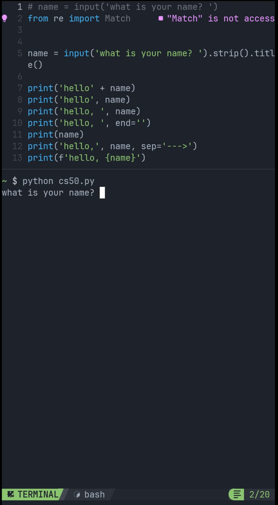

# The Ultimate Android Code Editor Guide

> Transform your Android phone into a powerful development environment with NvChad + Python LSP

[](https://opensource.org/licenses/MIT)
[](https://github.com/termux/termux-app)
[](https://neovim.io/)
[](https://nvchad.com/)

## 📱 What is This?

A comprehensive, step-by-step guide to set up a **professional-grade code editor** on your Android device using:
- **Termux** - Linux terminal emulator
- **Neovim 0.11+** - Modern text editor
- **NvChad** - Beautiful Neovim configuration
- **Python LSP** - Full IDE features (autocomplete, diagnostics, go-to-definition)

**No root required!** Works on any Android 7.0+ device.

## ✨ Features

Once set up, you'll have:

✅ Full Python development environment  
✅ LSP features (autocomplete, diagnostics, hover documentation)  
✅ Beautiful UI with icons and themes  
✅ File tree and terminal integration  
✅ Syntax highlighting for multiple languages  
✅ Git integration  
✅ Works completely offline after setup  

## 🎯 Why Choose This Setup?

### 1. 📚 Learn Vim the Right Way
Perfect for beginners who want to master Vim/Neovim:
- Start with a beautiful, configured environment
- Learn Vim keybindings gradually
- Practice daily on your phone during commute
- Build muscle memory with real projects
- No overwhelming blank Vim screen - NvChad guides you!

**Vim skills are timeless** - they work on ANY system, anywhere, forever.

### 2. 🔒 Fully Local & Independent
Complete freedom from internet dependency:
- **No cloud required** - everything runs locally on your device
- **No subscriptions** - completely free forever
- **Your code stays private** - never leaves your device
- **Works offline** - code on planes, trains, anywhere
- **No data limits** - use as much as you want
- **Full control** - customize everything

Unlike online IDEs (Replit, CodeSandbox), you own your environment completely.

### 3. 🌍 Code Anywhere, Anytime
Transform dead time into productive learning:
- **Commuting?** Practice algorithms on the bus
- **Waiting in line?** Fix that bug
- **Lunch break?** Learn a new language feature
- **Before bed?** Review code or read docs
- **No laptop needed** - your phone is enough

**Your phone becomes a portable coding lab** - always with you, always ready.

## 📸 Screenshots

### File Tree Explorer

*Integrated file explorer for easy navigation*

### Python Development with LSP

*Full LSP support: autocomplete, diagnostics, and go-to-definition*

### Integrated Terminal

*Built-in terminal for running Python scripts without leaving the editor*

## 🚀 Quick Start

### Time Required
- **Total:** ~20-30 minutes
- **Active time:** ~10 minutes (rest is downloading/installing)

### Prerequisites
- Android device (7.0+)
- 1GB free storage
- Internet connection
- Basic terminal knowledge (helpful but not required)

### Installation

```bash
# 1. Install Termux (see guide)
# 2. Update packages
pkg update
pkg upgrade -y

# 3. Install Neovim
pkg install neovim -y

# 4. Clone NvChad
git clone https://github.com/NvChad/starter ~/.config/nvim && nvim
```

**For complete step-by-step instructions, see [GUIDE.md](GUIDE.md)**

## 📖 Documentation

- **[Complete Setup Guide](GUIDE.md)** - Full installation instructions
- **[Troubleshooting](TROUBLESHOOTING.md)** - Common issues and solutions
- **[Keybindings](KEYBINDINGS.md)** - Essential shortcuts
- **[FAQ](FAQ.md)** - Frequently asked questions

## 🎯 What's Included

### Main Guide Sections

1. **Part 0:** Install Termux
2. **Part 1:** Initial Setup & Dependencies
3. **Part 2:** Install Neovim
4. **Part 3:** Manual Font Installation
5. **Part 4:** Verify Installations
6. **Part 5:** Backup Existing Config
7. **Part 6:** Clone NvChad
8. **Part 7:** Verify NvChad Installation
9. **Part 8:** Install Python LSP (Pyright)
10. **Part 9:** Verify Pyright Installation
11. **Part 10:** Create Config Structure
12. **Part 11:** Create LSP Configuration
13. **Part 12:** Verify Plugins Configuration
14. **Part 13:** Create Custom Init (Optional)
15. **Part 14:** Test Python LSP
16. **Part 15:** Troubleshooting

## 🛠️ Supported Languages

Out of the box, this setup includes LSP support for:
- ✅ Python (Pyright)
- ✅ Lua
- ✅ HTML/CSS
- ✅ JSON

**Easily add more:** JavaScript, TypeScript, Rust, Go, C/C++, and 50+ other languages via Mason.

## 📱 Tested Devices

This guide has been tested and confirmed working on:
- Google Pixel (various models)
- Samsung Galaxy (various models)
- OnePlus devices
- Xiaomi devices

Should work on any Android 7.0+ device with 2GB+ RAM.

## 🤝 Contributing

Contributions are welcome! Please feel free to submit a Pull Request. For major changes, please open an issue first to discuss what you would like to change.

### How to Contribute
1. Fork the repository
2. Create your feature branch (`git checkout -b feature/AmazingFeature`)
3. Commit your changes (`git commit -m 'Add some AmazingFeature'`)
4. Push to the branch (`git push origin feature/AmazingFeature`)
5. Open a Pull Request

## 📝 Changelog

### Version 1.0.0 (2025-01-18)
- Initial release
- Complete NvChad + Python LSP setup guide
- Neovim 0.11+ compatible configuration
- Termux v0.118.3 installation instructions
- Comprehensive troubleshooting section

## ⭐ Star History

If this guide helped you, please consider giving it a star! ⭐

## 🙏 Acknowledgments

- [Neovim](https://neovim.io/) - The editor
- [NvChad](https://nvchad.com/) - Beautiful Neovim configuration
- [Termux](https://termux.dev/) - Android terminal emulator
- [Mason.nvim](https://github.com/williamboman/mason.nvim) - LSP installer
- [Pyright](https://github.com/microsoft/pyright) - Python language server

## 📄 License

This project is licensed under the MIT License - see the [LICENSE](LICENSE) file for details.

## 💬 Support

- **Issues:** [GitHub Issues](https://github.com/yourusername/ultimate-android-code-editor-guide/issues)
- **Discussions:** [GitHub Discussions](https://github.com/yourusername/ultimate-android-code-editor-guide/discussions)

## 🔗 Related Projects

- [Termux App](https://github.com/termux/termux-app)
- [NvChad](https://github.com/NvChad/NvChad)
- [Neovim](https://github.com/neovim/neovim)

---

**Made with ❤️ for mobile developers**

*Transform your Android device into a powerful coding machine!*